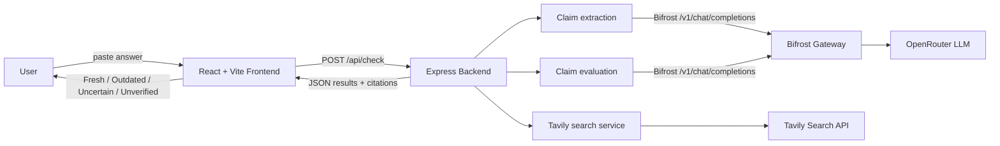

# FreshCheck AI

FreshCheck AI is an AI-powered stale-answer detector. Paste an AI-generated answer and it verifies each factual claim against live web evidence, classifying every claim as **Fresh**, **Outdated**, **Uncertain**, or **Unverified** (service failure), with supporting source links.

Built for the **Geek Room Global AI Hackathon 2026**.

## Problem

AI models can confidently produce answers that are stale, partially wrong, or unverified. Readers have no quick way to tell which claims are still accurate. FreshCheck AI turns a pasted answer into a per-claim verification report backed by live sources.

## Solution

FreshCheck AI splits a pasted answer into individual claims, searches the live web for evidence for each claim, and uses an LLM to judge whether the evidence supports, contradicts, or is insufficient for the claim. Results are shown with citations so users can inspect the sources themselves.

## Key features

- Paste an AI-generated answer and click **Check Freshness**.
- Backend endpoint `POST /api/check`.
- Claim extraction, evidence search, and claim evaluation are separate, testable service modules.
- Live web evidence via Tavily, with unrelated results filtered by subject.
- LLM requests routed through Bifrost (OpenAI-compatible) to an OpenRouter model.
- Per-claim status: **Fresh**, **Outdated**, **Uncertain**, or **Unverified**.
- Supporting evidence links for every verified claim.
- Loading, empty-input, and error states.
- Service failures are distinguished from genuinely uncertain claims.
- Mock mode (clearly labelled) for initial UI testing.
- Responsive blue/white dashboard for desktop and mobile.

## Tech stack

| Layer | Technology |
| --- | --- |
| Frontend | React 18, Vite 6 |
| Backend | Node.js 24, Express 4 |
| Search | Tavily (`@tavily/core`) |
| LLM gateway | Bifrost (OpenAI-compatible) → OpenRouter |
| Styling | Plain CSS |
| Tests | Node.js built-in test runner |

## Architecture



## Verification flow

1. **Paste answer** — user submits an AI-generated answer.
2. **Extract claims** — the backend asks the LLM (via Bifrost) to split the answer into complete, verifiable claims, preserving subject, action, and date. Relative dates (e.g. "next Tuesday") are resolved to absolute dates.
3. **Search evidence** — for each claim, the backend queries Tavily for live web results and filters out evidence unrelated to the claim's subject.
4. **Evaluate claims** — the LLM classifies each claim as Fresh, Outdated, or Uncertain using only the filtered evidence. Future predictions are never marked Fresh/Outdated without direct confirmation.
5. **Show results** — the frontend displays per-claim status, explanation, and clickable source links, plus an overall summary. Service failures are reported as `Unverified` / "Verification unavailable", not as Uncertain.

## Local Bifrost setup (optional)

Bifrost runs as a local OpenAI-compatible gateway and routes LLM requests to OpenRouter.

1. Start Bifrost locally:

```powershell
npx.cmd bifrost --host 0.0.0.0 --port 8080 --app-dir $env:APPDATA\bifrost
```

2. Configure an OpenRouter provider key in the Bifrost dashboard (http://localhost:8080) and create a virtual key.
3. Set `BIFROST_BASE_URL`, `BIFROST_VIRTUAL_KEY`, and `BIFROST_MODEL` in `.env` (for example `openrouter/openai/gpt-4o-mini`).

If Bifrost is unavailable, set `MOCK_MODE=true` to use clearly labelled mock results for UI testing.

## Environment variables

Copy `.env.example` to `.env` and fill in your values. All credentials are configured through environment variables; nothing is hardcoded.

| Variable | Description |
| --- | --- |
| `TAVILY_API_KEY` | Tavily API key |
| `BIFROST_BASE_URL` | Bifrost base URL (e.g. `http://localhost:8080`) |
| `BIFROST_VIRTUAL_KEY` | Bifrost virtual key |
| `BIFROST_MODEL` | Model id routed by Bifrost (e.g. `openrouter/openai/gpt-4o-mini`) |
| `PORT` | Backend port (default `3001`) |
| `MOCK_MODE` | Set to `true` to use clearly labelled mock results for UI testing |

## Setup

```bash
npm install
```

Copy the environment template (Windows PowerShell):

```powershell
Copy-Item .env.example .env
```

Then fill in your credentials in `.env` and start the app:

```bash
npm run dev
```

- Frontend: http://localhost:5173
- Backend API: http://localhost:3001

### Scripts

- `npm run dev` — run backend and frontend together
- `npm run server` — run only the Express backend
- `npm run client` — run only the Vite frontend
- `npm run build` — build the frontend
- `npm test` — run backend tests
- `npm run test:tavily` — smoke test Tavily connectivity

## Testing

```bash
npm test
npm run build
```

Tests cover mock mode, missing credentials, Tavily failures, Bifrost failures, invalid LLM JSON, source URLs, future-claim handling, and service-failure reporting.

## Example

Input:
> Microsoft's current CEO is Steve Ballmer. Microsoft was founded in 1975.

Result:
- "Microsoft's current CEO is Steve Ballmer." → **Outdated** — Steve Ballmer was CEO until 2014; the current CEO is Satya Nadella.
- "Microsoft was founded in 1975." → **Fresh** — supported by recent sources.

A future claim such as "Microsoft will definitely launch a new operating system next Tuesday." is marked **Uncertain** because the evidence does not directly confirm that specific future event.

## Service failures vs. uncertainty

- **Uncertain** means evidence was retrieved but was insufficient or indirect.
- **Unverified / Verification unavailable** means a service (Tavily or Bifrost) could not be reached or failed, so the claim was not actually evaluated. Failed claims are not counted as Uncertain.

## Limitations

- LLM accuracy depends on the model routed through Bifrost/OpenRouter.
- Source quality depends on Tavily results; irrelevant articles are filtered but not guaranteed to be removed.
- API rate limits (Tavily/OpenRouter) may cause partial or complete verification failures.
- Local Bifrost setup is required for real verification; without it, mock mode can be used for UI testing.
- No database, authentication, or deployment configuration is included (MVP scope).

## AI-assisted development disclosure

This project was built with AI assistance (OpenCode / Beam) for scaffolding, code generation, and documentation. All generated code was reviewed, tested, and adjusted by the developer. API keys and credentials are kept in local environment variables and are not committed.

## License

ISC